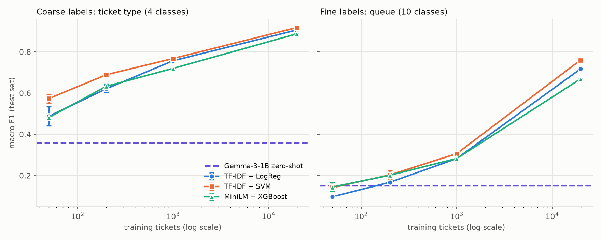

# SLM vs classical ML for support-ticket classification

**Question:** how does a zero-shot small language model (Gemma-3-1B) compare with classical ML classifiers on
support-ticket classification — in accuracy, macro F1, latency and memory — as training data and label
granularity vary, and is an SLM necessary for simple classification at all?

**Short answer:** on this task, no. Zero-shot Gemma-3-1B lost to every classical model at every training size
we tried, except at ~50 training tickets on the 10-class labels, where it is roughly level with them
(0.150 vs 0.10–0.14). It is also 250× slower
and uses 10–17× more memory than TF-IDF models.



## Setup
- **Data:** `Tobi-Bueck/customer-support-tickets`, English only, 28,261 tickets (see
  [docs/dataset-choice.md](docs/dataset-choice.md)). Split 70/15/15, stratified, fixed seed; test = 4,240 tickets.
- **Two label granularities:** *coarse* = ticket type (4 classes: Incident, Request, Problem, Change);
  *fine* = support queue (10 classes). These are two different label spaces, not a hierarchy: "coarse" means
  fewer classes.
- **Models:** TF-IDF (1–2-grams) + LogReg; TF-IDF + linear SVM (C tuned on val from {0.1, 1, 10});
  `all-MiniLM-L6-v2` embeddings + XGBoost (defaults); `gemma-3-1b-it` bf16 via MLX, **zero-shot**: the prompt lists
  the labels and we pick the label whose first distinguishing token has the highest log-probability (always a valid label).
- **Sweep:** 50 / 200 / 1,000 / full (19,782) training tickets; 3 seeds for 50 and 200 (mean ± std shown), 1 seed above.
  Gemma needs no training so it is a flat line.
- **Costs:** per-ticket latency at batch size 1 after warm-up (200 test tickets), throughput on those 200 in one call,
  peak RSS measured in an isolated subprocess per model.

## Results (macro F1 on the test set; full table in `results/summary.csv`)

| Model | coarse 50 | coarse 200 | coarse 1k | coarse full | fine 50 | fine 200 | fine 1k | fine full |
|---|---|---|---|---|---|---|---|---|
| TF-IDF + LogReg | 0.488 | 0.621 | 0.756 | 0.906 | 0.097 | 0.167 | 0.282 | 0.716 |
| TF-IDF + SVM | 0.573 | 0.689 | 0.767 | **0.917** | 0.142 | 0.203 | **0.306** | **0.759** |
| MiniLM + XGBoost | 0.481 | 0.633 | 0.719 | 0.887 | 0.144 | 0.202 | 0.282 | 0.668 |
| Gemma-3-1B zero-shot | 0.359 | 0.359 | 0.359 | 0.359 | 0.150 | 0.150 | 0.150 | 0.150 |

| Model | p50 latency | throughput | peak RSS |
|---|---|---|---|
| TF-IDF + LogReg / SVM | 0.22 ms | ~36–39k tickets/s | 0.23–0.68 GB |
| MiniLM + XGBoost | 4 ms | ~1.0–1.2k tickets/s | 0.74–1.13 GB |
| Gemma-3-1B zero-shot | 54 ms (coarse) – 75 ms (fine) | 10–16 tickets/s | 3.9 GB |

RSS includes the training process for the trained models (fit + predict), and the model weights for Gemma.

## What this says
- **Coarse labels (4 classes):** even 50 labeled tickets beat zero-shot Gemma (0.48–0.57 vs 0.36). There is no
  crossover inside the range we tested; if one exists it is below ~50 labels.
- **Fine labels (10 classes):** at 50 tickets Gemma's 0.150 edges out all three classical models (0.097–0.144), but every
  score there is very low (all near chance for 10 classes). By 200 tickets the SVM and XGBoost are ahead, and by
  the full set the classical models are ~4–5× better. So the SLM "wins" only when there is essentially no labeled
  data and many confusable classes, and then only barely.
- **Cost:** the classical models are 250× (SVM/LogReg) to 14× (XGBoost) faster per ticket and use a fraction of
  Gemma's memory. A zero-shot SLM buys you "no labels needed", and that is all it buys here.
- **Is an SLM necessary for a task like this?** No. If you have even a few hundred labeled tickets, TF-IDF + a
  linear model is more accurate, orders of magnitude cheaper, and easier to run.

## Caveats (read before quoting numbers)
- One SLM (1B parameters), one prompt, no prompt tuning, no few-shot examples. A larger model or a tuned prompt
  would likely score higher; this measures the smallest practical case, as intended.
- The dataset is LLM-generated and multilingual (we use English only). Its queue labels are somewhat ambiguous
  (the best classical model reaches only 0.76 macro F1 with 20k labels), which depresses every model on the fine labels.
- A single train/val/test split; only the small-size points have seed variance (3 seeds). Results at 1k and full
  have no error bars.
- Zero-shot latency covers one forward pass over a ~300-token prompt; we do not include model load time.
- Hardware: Apple M4 Pro, 24 GB. Latency and memory numbers do not transfer to other hardware.

## Reproduce
```bash
uv sync
uv run python scripts/recon_datasets.py   # optional: dataset comparison
uv run python scripts/run_sweep.py        # ~20 min on an M4 Pro; resumable; writes results/raw.csv
uv run python scripts/make_report.py      # results/summary.csv + results/crossover.png
uv run pytest
```
Requires the cached models `mlx-community/gemma-3-1b-it-bf16` and `sentence-transformers/all-MiniLM-L6-v2`
(downloaded automatically from Hugging Face on first use). See [CLAUDE.md](CLAUDE.md) for project conventions.
